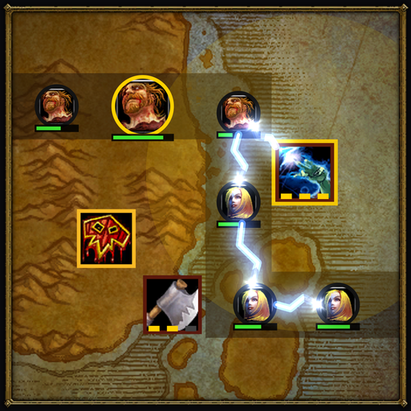

<p align="center">
  
</p>

# ForeverTD

A tower-defense minigame you play inside **WoW: Forever**: on flight paths, in queues, or whenever you have five minutes.

- **Four campaigns** in the spirit of Warcraft III: the Horde, the Alliance, the Sentinels and the Forsaken. Eight levels each, 32 in all, fought on the real zone maps of Azeroth, from the Valley of Trials to Shadowfang Keep.
- **Twenty towers**, five per campaign, each with two specializations, and a **hero** for every campaign: Thrall, Bolvar, Tyrande and Sylvanas, each with an ability that turns a wave.
- **Creeps and bosses with tricks:** stealth that only some towers can see through, healers, spiders that split when they die, summons, blinks, stomps and enrages. Each campaign's story is told in briefings, battle cries and boss lines.
- **Easy in and out:** close the window and the game pauses, mid-wave included. A `/reload` picks up the same moment.
- **Mouse only:** no keybinds, so every key stays yours while you play on the side.
- **Something to chase:** three stars per level, Heroic mode, and Warmarks to research your towers in each campaign's Armory.
- **Drawn with WoW's own art:** zone maps, spell icons and creature portraits from the game itself. The addon ships no images.

Solo, free, and for WoW: Forever (interface 16001). Found a bug, or a level that's too hard or too easy? Please [open an issue](https://github.com/brucestarlove/ForeverTD/issues): balance feedback is very welcome.

## Install

**CurseForge:** [ForeverTD on CurseForge](https://www.curseforge.com/projects/1771846) (awaiting CurseForge's approval; until then, the zip below).

**By hand (.zip):**

1. On the [releases page](https://github.com/brucestarlove/ForeverTD/releases/latest), download **`ForeverTD.zip`**. Not "Source code (zip)", which is listed right beside it: that one isn't the addon.
2. Unzip it into your AddOns folder. The zip already contains a folder named `ForeverTD`, so you should end up with `World of Warcraft\<your WoW: Forever folder>\Interface\AddOns\ForeverTD\ForeverTD.toc` (during the beta, the folder is `_classic_beta_`).
3. Restart the game. A `/reload` doesn't pick up a newly installed addon.

The folder has to be called exactly `ForeverTD` and sit directly in `AddOns`. If Windows' "Extract All" wrapped it in a second folder, move the inner `ForeverTD` up into `AddOns`.

## Play

Type **`/td`**, or click ForeverTD in the minimap's addon menu. Pick a campaign and a level, place towers on the open cells beside the road, and stop every wave before it gets through. Close the window whenever you need to: the game waits for you.

| Command | What it does |
|---|---|
| `/td` | Open or close the game (closing pauses it) |
| `/td levels` | Choose a level |
| `/td armory` | Spend Warmarks on research |
| `/td new` | Restart the current level |
| `/td sound`, `/td auto` | Turn sound or auto waves on or off |
| `/td story`, `/td effects` | Turn briefings and battle cries, or the full effects, on or off |
| `/td scale 0.9` | The window's size, from 0.6 to 1.6 |
| `/td save` | Write your progress to disk now (reloads the UI) |
| `/td diag` | Performance and what's on the board, for bug reports |
| `/td help` | List these |

The Horde and the Alliance are open from the start. The Sentinels open at 30 stars and the Forsaken at 55. Within a campaign, each level opens the next, and every campaign ends in a siege against its big boss.

**Your progress** is saved by WoW itself, which writes it to disk when you log out or `/reload`. If the game crashes, play since your last reload is lost, so `/td save` after a long session doesn't hurt.

## Built with the Forever Custom Games Dev Kit

ForeverTD was built with the **Forever Custom Games Dev Kit**: the platform research, game patterns and code pieces for building minigame addons for WoW: Forever, with an AI coding assistant or by hand. It went from an empty folder to all four campaigns in two days, then a week of tuning from real play. More at [lavitz.starlove.world](https://lavitz.starlove.world).

## Development

The game's rules are pure Lua 5.1 with no WoW calls, so they run and are tested outside the client; a thin shell connects them to WoW.

| Path | What's there |
|---|---|
| `ForeverTD/` | The addon. `Engine.lua` (the simulation), `Meta.lua` (progress and research), `Levels.lua`, `Campaigns/*.lua` (towers, creeps, levels and waves as data) and `Story.lua` are pure; `Board.lua`, `Ui.lua`, `Menu.lua` and `Shell.lua` draw it and talk to WoW. |
| `ForeverTD/Dev/` | Dev tools (`/td dev`: a performance bench, icon, creature and map browsers, a client probe). Releases leave them out. |
| `tests/` | The test suite, with a stub of the WoW API (`lua tests/run.lua`). |
| `tools/` | `sim.lua` (the balance simulator), `metasim.lua` (the Warmarks economy over hours of play), `package.lua` (a local players' zip), `dev-report.lua` (reads a tester's saved progress). |

**Set up:** install Lua 5.1 and luacheck (on Windows, `scoop install lua-for-windows luacheck`), then link the addon folder into the client so edits are live after a `/reload` (new files need a restart):

```
mklink /J "C:\Program Files (x86)\World of Warcraft\_classic_beta_\Interface\AddOns\ForeverTD" "<this repository>\ForeverTD"
```

**Check:** `lua tests/run.lua` (a few minutes: the balance checks play every level) and `luacheck ForeverTD tests tools` (0 warnings).

**Balance:** two bots play every level. *Greedy* stands in for a sensible newcomer (a mixed build on good cells, with a little research); *sharp* for a good player (it tries each purchase on a copy of the game and buys what works). Normal must stay winnable for the newcomer with some margin, and for the good player with no research at all. `lua tools/sim.lua` checks every level, `--headroom` shows how much tougher each level could be, `--waves` does the same wave by wave, and `--scale 90 <level> --write` makes a level 10% easier. Read `tools/sim.lua`'s header for the rest.

**Release:** push a tag (`git tag v1.0.1 && git push origin v1.0.1`). GitHub Actions runs the [BigWigs packager](https://github.com/BigWigsMods/packager), which builds `ForeverTD.zip` without the dev tools (`.pkgmeta`, and the TOC's `#@debug@` blocks), sets the TOC's version from the tag, attaches the zip to a GitHub release and uploads it to CurseForge (the project ID is in `ForeverTD.toc`; the token is the repository's `CF_API_KEY` secret). `lua tools/package.lua 1.0.1` builds the same zip locally, for a clean-install test.

## License

[MIT](LICENSE): learn from it, fork it, make your own; keep the copyright notice.

ForeverTD is a fan-made addon, not affiliated with or endorsed by Blizzard Entertainment. World of Warcraft, its names and its art belong to Blizzard; the addon only refers to art that's already in the game client.

Made by Lavitz Starlove.
